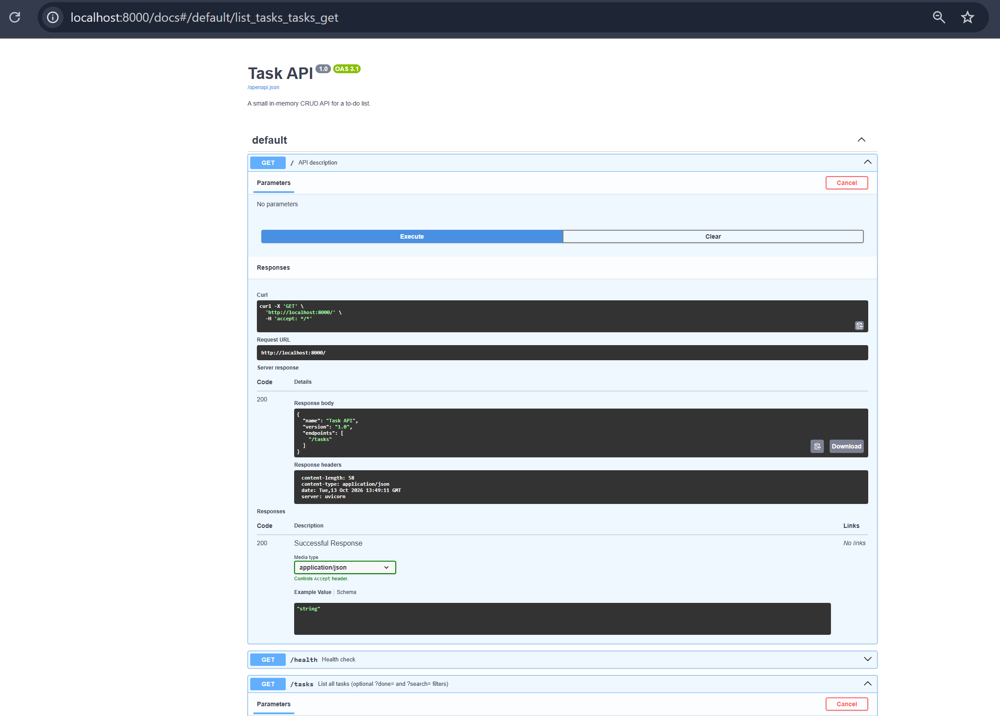

# Task API

A small in-memory CRUD API for a to-do list, built with Python and FastAPI.
Data lives in a Python list, so it resets whenever the server restarts.

## Install & run

```powershell
python -m venv .venv
.venv\Scripts\activate
pip install -r requirements.txt
uvicorn main:app --reload
```

Server: http://localhost:8000 · Swagger UI: http://localhost:8000/docs

## Endpoints

| Method | Path | Description | Success | Errors |
|--------|------|-------------|---------|--------|
| GET | `/` | API description | 200 | |
| GET | `/health` | Health check | 200 | |
| GET | `/tasks` | List tasks (`?done=true`, `?search=milk`) | 200 | |
| GET | `/tasks/{id}` | Get one task | 200 | 404 |
| POST | `/tasks` | Create a task `{"title": "..."}` | 201 | 400 |
| PUT | `/tasks/{id}` | Update `title` and/or `done` | 200 | 400, 404 |
| DELETE | `/tasks/{id}` | Delete a task | 204 | 404 |
| GET | `/stats` | Counts: total / done / open | 200 | |
| POST | `/reset` | Restore the 3 starter tasks | 200 | |

## Example `curl -i`

```
curl.exe -i http://localhost:8000/tasks/99

HTTP/1.1 404 Not Found
date: Tue, 13 Oct 2026 14:06:40 GMT
server: uvicorn
content-length: 29
content-type: application/json

{"error":"Task 99 not found"}
```

## Swagger UI



## The mortality experiment

I created a task, stopped the server, started it again and called `GET /tasks`. The new task was gone and only the 3 starter tasks remained, because the data is stored in a Python list in memory, which is erased when the program stops. A database would fix this by saving the data outside the program.